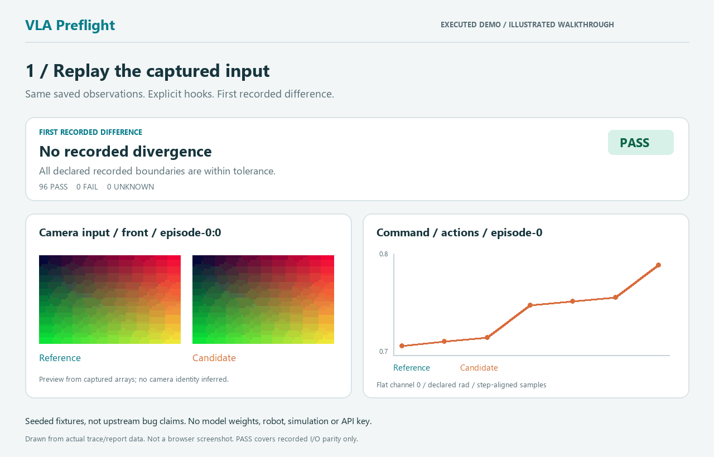

# VLA Preflight

**Find the first recorded boundary that changed when connecting a policy to your environment.**

Replay the same observation through reference and candidate pipelines. Compare
camera inputs, state preprocessing, action scaling and chunk/reset behavior before
spending a robot session debugging a shape-correct array.



*Data-rendered walkthrough from the executed CPU demo, not a browser screenshot.
Faults are deliberately injected. They are not reported upstream bugs.*

[中文说明](README.zh-CN.md) · [Capture your pipeline](docs/capture.md) ·
[Two real upstream paths](docs/integrations.md) · [Verification and limits](docs/verification.md)

```sh
git clone https://github.com/David1726/vla-preflight.git
cd vla-preflight
```

## Try it locally

Python 3.10+; core runtime depends only on NumPy. No robot, GPU, model weights,
server or API key. This is a release candidate; no PyPI release is assumed.
From this source directory:

```powershell
# Windows PowerShell
python -m venv .venv
.venv/Scripts/python.exe -m pip install --no-cache-dir --index-url https://pypi.org/simple .
.venv/Scripts/python.exe -m vla_preflight demo --out demo-output
Start-Process demo-output/index.html
```

```sh
# Linux / macOS
python3 -m venv .venv
.venv/bin/python -m pip install --no-cache-dir --index-url https://pypi.org/simple .
.venv/bin/python -m vla_preflight demo --out demo-output
# Open demo-output/index.html in your local browser.
```

Use a **new output directory** on subsequent demo runs. Installation needs package
downloads; running the installed demo and opening the report works offline.
The recipe disables pip's global cache so it also works when that inherited
directory is unwritable. Fresh-environment timings, with cache conditions stated, are saved in
[quickstart evidence](docs/evidence/quickstart.json).
The successful measured run took **33.4 seconds** on this Windows machine,
including a new environment, source installation and all demo reports. Pip cache
was disabled; earlier attempts may have warmed OS/network caches. The earlier
cache-permission failure is recorded too. Download time on another machine will vary.

The demo writes a clickable index, ten HTML/JSON reports, safe numeric traces,
and deterministic lifecycle probe results. Start with `camera_mapping`, then
`missing_reset`, then `fixed`.

| Scenario | Expected result | First recorded difference |
| --- | --- | --- |
| Healthy reference replay | PASS | None |
| **Seeded** camera swap | FAIL | `model_input / front`, episode-0, step 0 |
| **Seeded** wrong / repeated inverse scaling | FAIL / FAIL | `command / actions`, episode-0, step 0 |
| **Seeded** skipped chunk element | FAIL | `model_output / actions`, episode-0, step 0 |
| **Seeded** caller omits reset | FAIL | `model_output / actions`, episode-1, step 0 |
| Fixed pipeline, all four integration settings restored | PASS | None |
| Missing units / missing hook / unfixed randomness | UNKNOWN / UNKNOWN / UNKNOWN | Insufficient evidence |

These fixtures detected five seeded cases with no missed seeded case and no
healthy false alarm. This is a reproducible regression demonstration, not an
estimate of detection rate on real deployments.

## Use it in a policy change or PR

Capture reference and candidate with the same recorded raw observations and fixed
randomness. Declare the physical meaning of each field; shapes alone are insufficient.

```sh
vla-preflight compare traces/reference traces/candidate --out parity-report
```

Exit codes: **0 PASS**, **1 FAIL**, **2 UNKNOWN**, **3 invalid evidence or command**.
UNKNOWN fails a normal CI step. The report embeds camera thumbnails, first
numeric mismatch, per-episode action curves, a filterable stage timeline, tolerance
evidence and version provenance. No external scripts, fonts or network requests.
Graphs preview flat channel 0; numeric comparisons cover every element.

[Minimal capture and replay tutorial](docs/capture.md) ·
[Copyable GitHub Actions workflow](.github/workflows/ci.yml) ·
[Instrument your own PR](examples/check_parity.py)

```text
Recorded raw observations ──> reference pipeline ──> explicit stage hooks ─┐
                         └─> candidate pipeline ──> explicit stage hooks ─┤
                                  JSON + numeric NPY traces             │
                                            compare <──────────────────┘
                                               │
                              HTML + JSON + CI exit code
                     deterministic chunk/reset probes run separately
```

## What has actually run?

| Path | Executed code | Local evidence | Not executed |
| --- | --- | --- | --- |
| NumPy demo | All capture, replay, diff, report and lifecycle paths | 10 scenarios; healthy → seeded failures → fixed; 3 UNKNOWN controls | Trained policy, simulation, robot |
| OpenPI `215abfb…` | Original `ActionChunkBroker.infer/reset`, real dm-tree, deterministic synthetic inner policy | Healthy/fixed pass; wrapper's extra consumption and omitted reset fail; single-session probes | OpenPI model, websocket transport, rollout; multi-session unsupported and skipped |
| LeRobot `53feaef…` | Original MEAN_STD normalizer/unnormalizer, real types, converters and base pipeline | Healthy/fixed pass; caller's repeated inverse fails at command; explicit expected values and no raw-input mutation checked | Whole-package install/initializers, all normalization modes, pretrained model, dataset, robot |

LeRobot validation loads unmodified pinned source modules with package initializers
isolated to avoid unrelated dependencies. It is processor-slice compatibility,
not a claim that every LeRobot installation/version is supported. The tutorial
also shows where to insert hooks in an existing fully installed LeRobot project.
[Exact revisions, commands and loading boundary](docs/integrations.md).

## Interpretation boundaries

- PASS means parity within declared tolerances at the recorded boundaries. A
  trusted reference is your responsibility; two identically incorrect pipelines
  can pass. It is not model task success or robot safety certification.
- The first recorded difference is a failing boundary, not an inferred source
  line. With only input/output hooks, intermediate operations remain unobserved.
- Missing stage/field evidence, semantic declarations, empty arrays or unfixed
  randomness yield UNKNOWN. Explicit contract/shape conflicts and nonfinite
  arrays fail. A FAIL can coexist with UNKNOWN rows; coverage remains visible.
- No automatic inference of camera identity, units, coordinates or normalization;
  no implicit unit conversion or axis transposition. Explicit renaming and
  per-field tolerances are supported.
- Traces are JSON and numeric NPY (`allow_pickle=False`), with array digests and
  path checks. They are local artifacts, not a sandbox for arbitrary hostile
  multi-gigabyte inputs. Capturing is synchronous and can add latency.

## Existing tools and fit

[OpenPI PolicyRecorder](https://github.com/Physical-Intelligence/openpi/blob/215abfb217dbac7d5f1273282331b9b1866c0479/src/openpi/policies/policy.py)
already records policy inputs/outputs; its broker already implements chunk
consumption and reset. VLA Preflight adds an explicit cross-pipeline comparison
and CI/report workflow around recorded boundaries. The broker tests here verify
caller integration rather than alleging a broker defect.

[AllenAI's evaluation harness](https://github.com/allenai/vla-evaluation-harness)
covers model/simulation evaluation;
[Viam's inference service](https://github.com/viam-labs/vla-inference-service)
includes deployment and replay diagnostics;
[Tether](https://github.com/FastCrest/tether) covers export/deployment parity;
[ActionShift](https://github.com/Archerkattri/actionshift) studies action contracts;
[VLA-Trace](https://github.com/VLA-Trace/vla-trace) covers model/behavior diagnostics.
There is overlap. This project focuses on caller-declared I/O and lifecycle
regressions with a small offline workflow. It does not claim to be the first.

## Contribute or prepare a release

[Contribution guide](CONTRIBUTING.md) describes adding a real adapter, an
anonymized regression trace or a diagnostic case with a healthy control.
[Release checklist](docs/releasing.md) covers local wheel/sdist checks and source
packaging. See [GitHub Actions](https://github.com/David1726/vla-preflight/actions)
for current remote CI status; the committed local evidence is labeled separately.

MIT for the core; the optional original upstream fixtures retain Apache-2.0.
See [third-party attribution](THIRD_PARTY.md). The GitHub repository is
`David1726/vla-preflight`; PyPI name availability has not been reserved or guaranteed.
